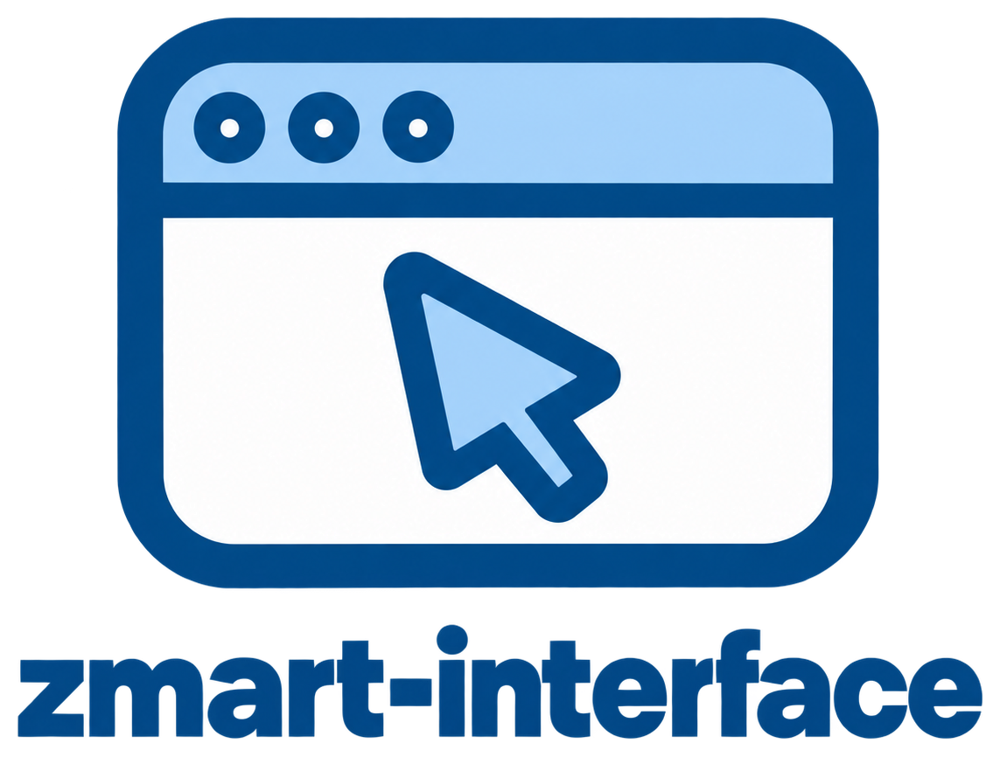
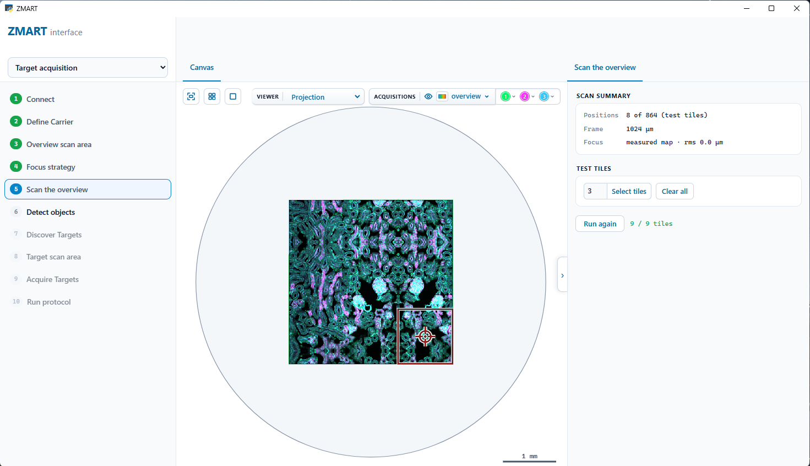

# ZMART interface

The **ZMART interface** provides a visual way to setup and control your smart microscopy workflow. It drives the microscope through  through the [ZMART Controller](https://github.com/ZMB-UZH/ZMART-controller), so it works on any microscope with a ZMART driver. The image analysis engine is provided by the ZMART Analysis pipeline engine.

It is part of [**ZMART**](https://github.com/ZMB-UZH/ZMART-microscopy) (ZMB's Microscopy-Agnostic Research Toolkit), the tools we use for smart microscopy at the Center for Microscopy and Image Analysis (ZMB), University of Zurich.
 
 

## The Problem
A smart microscopy workflow becomes easily very complex and can be hard to fine tune visualize, scale and simulate. 

 

## The Solution
The ZMART interface provides a unified interactive framework and playground that allows you to easily simulate, fine tune and automate your workflow. We are currently testing it on the leica stellaris, but it can easily adapted to any microscope because it build on top of the ZMART controller.

 

 

## Status
This is a release candidate, 0.1.0rc4. We are currently are in the process of testing it on the Leica Stellaris

## Try it yourself
Install it and test it:

- [Install and run the interface with its dependencies](docs/install-on-a-microscope.md)
- [The target acquisition workflow](zmart_interface/workflows/target_acquisition)
- [Write a new workflow](docs/dropping-a-workflow-in.md)
- [The workflow API a workflow is written against](docs/the-workflow-api.md)
- [How the interface is put together](docs/architecture.md)

## Author
Thom de Hoog, Center for Microscopy and Image Analysis (ZMB), University of
Zurich (thom.dehoog@zmb.uzh.ch, thomdehoog@gmail.com).

## License
MIT License. See LICENSE file for details.
